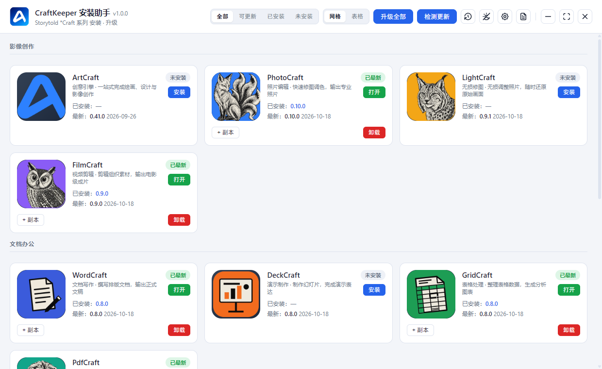

# CraftKeeper

English | [简体中文](./README.md)

**A Windows desktop installer & updater that manages your favorite \*Craft creative apps in one place — install, update, backup & restore, all automatic.**

> Portable executable — download and double-click to run, no installation
>
> Completely free. Independent tool, not affiliated with the official teams

---

## Why CraftKeeper

Your favorite \*Craft tools — ArtCraft, PhotoCraft, LightCraft and more — get updated often. Checking each website and downloading updates by hand is slow and easy to miss. CraftKeeper handles installing, updating, backing up and restoring everything in one place, automatically.

## Features

- **One-click update check** — automatically checks all products for new versions
- **Smart install** — picks the right installation method for your Windows system, no need to tell them apart
- **Safe, resumable downloads** — interrupted downloads resume automatically; broken installers are re-downloaded
- **Auto-backup before upgrading** — one-click restore if anything goes wrong (keeps the last 5 backups)
- **Batch upgrade** — update all outdated products in one go
- **Self-updating tool** — downloads new versions in the background, one click to upgrade
- **Auto-discovery** — newly released \*Craft apps appear automatically
- **Light/dark theme**, zh/en UI

## Supported Products

CraftKeeper manages all of the following creative tools from one place:

| Product | Description |
|---|---|
| ArtCraft | All-in-one drawing, design & image creation |
| PhotoCraft | Fast photo editing & color grading |
| LightCraft | Non-destructive photo retouching |
| FilmCraft | Video editing & cinematic output |
| WordCraft | Document writing & formatting |
| DeckCraft | Slide deck creation & presentation |
| FigCraft | UI prototyping & interface design |
| DesignCraft | Layout & print-ready visual design |
| EffectCraft | Motion graphics & visual effects |
| SoundCraft | Audio recording, mixing & production |
| GridCraft | Spreadsheet & data analysis |
| AniCraft | 2D animation & keyframe drawing |
| CADCraft | Engineering drawing & CAD documents |
| PdfCraft | PDF reading, organizing & protection |
| VectorCraft | Vector drawing, lossless & infinitely scalable |

## Quick Start

1. **Download** `craftkeeper.exe` (see options below)
2. **Double-click to run** — no installation needed
3. **Pick a product**: the app lists installable \*Craft tools; click to install or update

## Download

**Option 1 (recommended)**: Click **Releases** on the right side of this page and download the latest `craftkeeper.exe` (for Windows 64-bit, run directly).

**Option 2 (China mirror, faster)**: Quark Cloud Drive, no sign-up required:
<https://pan.quark.cn/s/0de3c6bf4519>

> **System requirements**: Windows 10 / 11 (64-bit). Portable & green — nothing is written to system directories; delete the file to uninstall.

## Auto-Update

CraftKeeper checks for new versions automatically: when an update is found, it downloads it quietly in the background, then one click on **Update Now** upgrades the tool — no need to reinstall, and your data stays safe.

> **Important**: v1.0.0 and v1.0.1 have a broken self-update (checking for updates reports an error). If you're on either version, please manually download the latest `craftkeeper.exe` and overwrite the old file. Self-update works again from v1.0.2 onwards.

## FAQ

- **Why is some product shown as "Not installable"?** The developer hasn't released a Windows installer for this version yet. Once they do, you can install it right from CraftKeeper.
- **Why do I need to install some apps manually?** A few installers don't support fully automatic installation. CraftKeeper keeps the installer and shows you where to run it — this is normal.
- **Why does checking for updates occasionally fail?** The network can be unstable from time to time — just try again later. If downloads are slow, enable the speed-up option in Settings.

## License

MIT — see [LICENSE](LICENSE).
