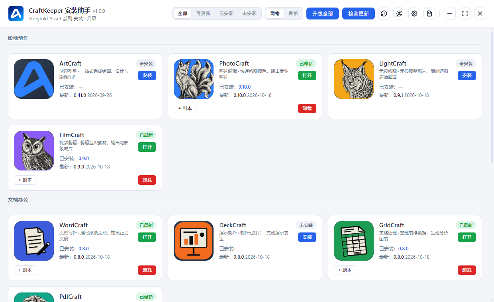

# CraftKeeper

[English](./README.en.md) | 简体中文

**Windows / macOS 桌面安装与升级管家：一个工具自动管理你常用的 Craft 系列创作软件，安装、升级、备份、还原全搞定。**

> Windows 免安装便携版，双击即用；macOS 版下载 dmg，拖入「应用程序」即完成安装
>
> 完全免费，独立工具，与官方无隶属关系

---

## 为什么需要 CraftKeeper

你常用的 ArtCraft、PhotoCraft、LightCraft 等 \*Craft 软件会经常更新。以前每次都要一个个去官网查看、手动下载安装，费时费力，还容易漏装。有了 CraftKeeper，安装、升级、备份和还原都能在一个工具里自动完成。

## 功能特性

- **一键检测更新**：自动检查所有产品是否有新版本
- **自动选对安装包**：根据你的操作系统（Windows / macOS）自动选择合适的安装方式，无需手动分辨
- **下载安全可靠**：下载中断自动续传，损坏的安装包自动重新下载
- **升级前自动备份**：万一装坏了可一键还原，最多保留最近 5 份备份
- **批量升级**：一次把有新版的产品全部升到最新版
- **工具自动更新**：发现新版后后台下载，一键完成升级（Windows / macOS 均支持）
- **自动发现新应用**：官方新推出的 \*Craft 产品会自动出现在列表里
- **深色/浅色主题，中英双语界面**

## 支持的产品

CraftKeeper 支持以下创作软件，一个工具统一管理：

| 产品        | 中文名   | 简介                           |
| ----------- | -------- | ------------------------------ |
| ArtCraft    | 创意引擎 | 一站式完成绘画、设计与影像创作 |
| PhotoCraft  | 照片编辑 | 快速修图调色，输出专业照片     |
| LightCraft  | 无损修图 | 无损调整照片，随时还原原始画面 |
| FilmCraft   | 视频剪辑 | 剪辑组织素材，输出电影级成片   |
| WordCraft   | 文档写作 | 撰写排版文档，输出正式文稿     |
| DeckCraft   | 演示制作 | 制作幻灯片，完成演示表达       |
| FigCraft    | 界面设计 | 绘制界面原型，快速验证方案     |
| DesignCraft | 版式设计 | 排版页面视觉，输出印刷级成品   |
| EffectCraft | 动效合成 | 制作动态图形，合成视觉特效     |
| SoundCraft  | 音频制作 | 录制混音音频，产出专业声音     |
| GridCraft   | 表格处理 | 整理表格数据，生成分析图表     |
| AniCraft    | 2D 动画  | 绘制关键帧，生成流畅动画 |
| CADCraft    | 工程制图 | 绘制工程图纸，输出规范图档     |
| PdfCraft    | PDF 处理 | 阅读整理 PDF，保护文档安全     |
| VectorCraft | 矢量绘图 | 绘制矢量图形，无损无限缩放     |
| TextureCraft | 3D 纹理 | 在模型上绘制 PBR 材质，烘焙纹理贴图 |
| MaterialCraft | 材质设计 | 基于节点的材质设计器 |
| Craft Anything | 软件复刻 | 拆解任意软件工作原理，动手复刻构建 |
| PresentCraft | 演示文稿 | 用 Markdown 编写演讲稿，一键设计，随时演示或导出 |
| ShapeCraft | 实体建模 | 草图推拉成实体，导出 STL 直接打印 |

## 快速开始

Windows：

1. **下载** `craftkeeper.exe`（见下方下载方式）
2. **双击运行**——无需安装，直接打开
3. **选择产品**：软件会自动列出可安装的 Craft 产品，点击即可安装或升级

macOS：

1. **下载** `craftkeeper.dmg`（见下方下载方式）
2. **打开 dmg**，把 CraftKeeper 拖入「应用程序」文件夹
3. 首次打开若提示「无法验证开发者」：**右键点击 CraftKeeper → 「打开」**（只需一次）
4. **选择产品**：自动安装产品到「应用程序」，点击即可安装或升级

## 下载

**方式一（推荐）**：点击页面右侧 **Releases（发布页）**：
- Windows 64 位：下载最新版 `craftkeeper.exe`，直接运行即用
- macOS（Intel / Apple Silicon）：下载最新版 `craftkeeper.dmg`，拖入「应用程序」即完成安装

**方式二（国内更快）**：夸克网盘下载，无需注册登录：
<https://pan.quark.cn/s/c8b540eb536c>

> **系统要求**：Windows 10 / 11（64 位），或 macOS。Windows 版免安装、绿色便携，不写入系统目录，卸载即删除；macOS 版为独立应用，拖入废纸篓即卸载。

## 自动更新

CraftKeeper 会自动检查新版本：发现新版后**后台静默下载**，下载完成后点击「立即更新」即可升级到最新版——无需重新下载安装，数据也不会丢失（Windows / macOS 均支持）。

## 常见问题

- **为什么有的产品显示「不可安装」？** 该产品的开发团队这次发布的新版本还没有提供你所用系统的安装包（Windows 为 exe/msi，macOS 为 dmg/pkg），等官方发布后即可在 CraftKeeper 中直接安装。
- **mac 首次打开提示「无法验证开发者」怎么办？** 右键点击 CraftKeeper → 「打开」；或到「系统设置 → 隐私与安全性」点击「仍要打开」，之后可正常双击启动。
- **为什么安装某些软件时需要手动操作？** 少数软件的安装程序不支持全自动安装，CraftKeeper 会保留安装包并提示你手动完成，属正常现象。
- **为什么偶尔检测更新失败？** 网络有时不稳定，稍等片刻重试即可；下载慢时可在设置中开启加速通道。

## 许可证

MIT — 见 [LICENSE](LICENSE)。
